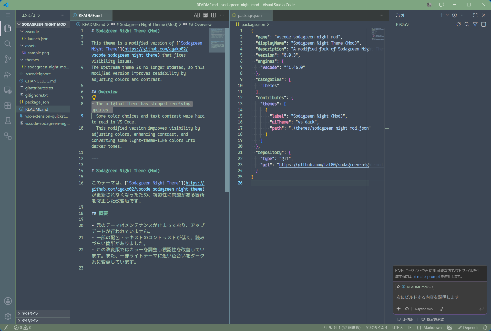

# Sodagreen Night Theme (Mod)

## Preview プレビュー

This theme is a modified version of [`Sodagreen Night Theme`](https://github.com/ayako02/vscode-sodagreen-night-theme) that fixes visibility issues.
The upstream theme is no longer updated, so this modified version improves readability by adjusting colors and contrast.

## Overview

- The original theme has stopped receiving updates.
- Some color choices and text contrast were hard to read in VS Code.
- This modified version improves visibility by adjusting colors, enhancing contrast, and converting some light-theme-like colors into darker tones.

---

# Sodagreen Night Theme (Mod)

このテーマは、[`Sodagreen Night Theme`](https://github.com/ayako02/vscode-sodagreen-night-theme) が更新されなくなったため、視認性に問題がある箇所を修正した改変版です。

## 概要

- 元のテーマはメンテナンスが止まっており、アップデートが行われていません。
- 一部の配色・テキストのコントラストが低く、読みづらい箇所がありました。
- この改変版ではカラーを調整し視認性を改善しています。また、一部ライトテーマに近い色合いをダーク系に変更しています。
